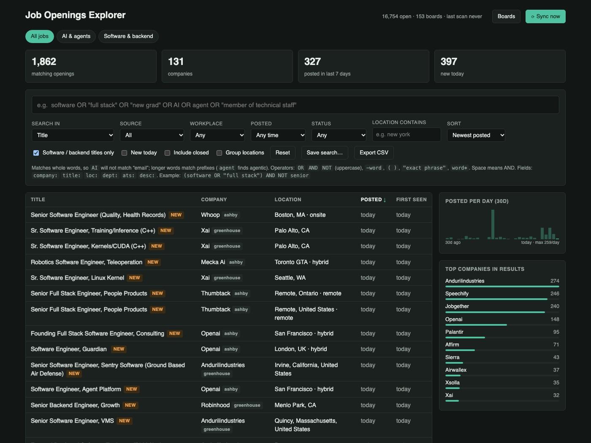
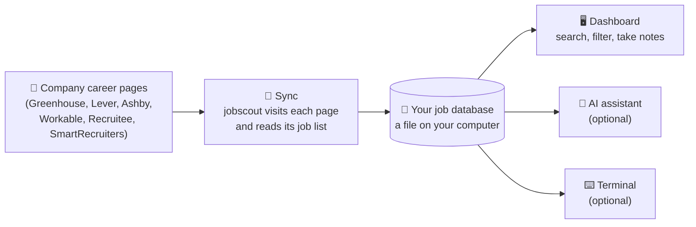

# jobscout

**Find job openings straight from company career pages, before they show up on job sites, and keep track of them on your own computer.**

jobscout checks the career pages of the companies you care about, saves every opening to a file on your computer,
and shows them in a searchable dashboard in your web browser. It remembers what it has seen before, so it can tell you
**what's new today** and **which jobs have been taken down**.



- **Free and private.** Everything stays on your computer. No account, no sign-up, nothing is sent anywhere except requests to the career pages themselves.
- **One small program.** No installation wizard and nothing else to set up. Works on Mac, Windows and Linux.
- **Nothing is lost.** Your jobs, notes and statuses survive restarts and reboots.
- **Works with AI assistants** such as Claude, which can search your jobs and keep notes for you (optional).

---

## How it works



1. **Companies** publish their openings on hiring platforms such as Greenhouse or Lever. jobscout comes with about 150 tech companies already added, and you can add any other company in seconds.
2. **Sync** (one click) visits every company's page and reads the current list of openings.
3. **Your database** keeps every job it has ever seen: when it first appeared, when it was last seen, and whether it has been taken down.
4. **The dashboard** lets you search, filter, save searches, mark jobs as *applied*, and keep notes.

## Get started in 3 steps


1. **Download** the file for your computer from the [Releases page](https://github.com/manikanta-varaganti/jobscout/releases) and unzip it.
   - **Mac:** `darwin_arm64` for Apple-silicon Macs (M1 and later), `darwin_amd64` for Intel Macs.
   - **Windows:** `windows_amd64`.
2. **Double-click `jobscout`** (`jobscout.exe` on Windows). The first time, your computer may ask you to confirm
   ([how](docs/user-guide.md#if-your-computer-blocks-it)).
3. **That's it.** A small window opens (keep it open while you use jobscout) and your browser shows the dashboard.
   The first time, jobscout fetches openings from about 150 companies; the list fills in within a minute or two.

While it's running, jobscout refreshes the jobs every 6 hours, and whenever you open it after more than 6 hours.
You can also click **⟳ Sync now** at any time. To stop it, close the small window.

Prefer the terminal? `jobscout serve` does the same thing; `jobscout help` lists every command.

## What you can do

| I want to… | How |
|---|---|
| Find jobs that match me | Type in the search box, e.g. `backend OR "full stack" -senior` ([search guide](docs/user-guide.md#searching)) |
| See only what's new | Tick **New today**, or open a saved search: its badge shows how many are new since you last looked |
| Follow a company that's not listed | **Boards → paste any of its job links → Add**, then **Sync now** |
| Keep track of applications | Click a job, set its status to *applied*, add a note |
| Avoid seeing the same job 5 times (one per city) | Tick **Group locations** |
| Use the list in Excel or Google Sheets | **Export CSV** |
| Let Claude help me | See [Using jobscout with an AI assistant](docs/mcp.md) |

## Documentation

| Guide | For |
|---|---|
| 📘 **[User Guide](docs/user-guide.md)** | Everyone: installing, daily use, searching, saved searches, tracking applications |
| ❓ **[FAQ & Troubleshooting](docs/faq.md)** | "Why is a job missing?", "Where is my data?", "Mac says it can't open the app" |
| 🤖 **[AI assistants (MCP)](docs/mcp.md)** | Connecting Claude or other assistants |
| 🏗️ **[Architecture](docs/architecture.md)** | Developers: how it's built, with diagrams |
| 🔌 **[HTTP API](api/openapi.yaml)** | Developers: the local REST API |
| 🧭 **[Decision records](docs/adr/)** | Developers: why it's built this way |
| 🤝 **[Contributing](CONTRIBUTING.md)** · 🔒 **[Security](SECURITY.md)** · 📝 **[Changelog](CHANGELOG.md)** | Contributors |

## Your data

Your job database is one file. It stays where it is when you update or delete the jobscout program.

| Computer | Location |
|---|---|
| Mac | `~/Library/Application Support/jobscout/jobscout.db` |
| Windows | `%AppData%\jobscout\jobscout.db` |
| Linux | `~/.config/jobscout/jobscout.db` |

Back it up any time with `jobscout backup my-backup.db` (safe while jobscout is running).

---

<details>
<summary><b>For developers and power users</b> (command line, configuration, building from source)</summary>

### Build from source

Requires Go 1.27+ (no C compiler needed):

```sh
git clone https://github.com/manikanta-varaganti/jobscout && cd jobscout
make build            # -> bin/jobscout
make check            # format check, vet, tests with the race detector
```

### Commands

```text
jobscout                              start the dashboard (what double-clicking does)
jobscout init                         create the database and load ~150 starter companies
jobscout scan                         sync every company now (no browser needed)
jobscout serve [--scan-every 6h] [--sync-if-older 6h]
                                      dashboard + API at http://127.0.0.1:8765
jobscout search QUERY [--target] [--new] [--group] [--posted-days N] [--json]
jobscout board list|add|add-url|enable|disable|rename
jobscout saved list|add NAME QUERY [flags]|rm ID
jobscout mcp [--allow-write]          MCP server on stdio for AI assistants
jobscout import FILE...               load legacy JSONL snapshots
jobscout maintenance [--prune-closed 90d] [--vacuum]
jobscout backup DEST.db | stats | version
```

### Search syntax

| Syntax | Meaning |
|---|---|
| `python backend` | both words (a space means AND) |
| `software OR "full stack"` | either; `OR`, `AND`, `NOT` must be uppercase |
| `-senior`, `NOT senior` | exclude |
| `( … )` | grouping, e.g. `(software OR "full stack") AND NOT senior` |
| `"member of technical staff"` | exact phrase |
| `agent*` | prefix. Words longer than 3 letters already match as prefixes; shorter ones (`AI`) match whole words only |
| `company:stripe`, `title:`, `loc:`, `dept:`, `desc:`, `ats:` | restrict a term to one field |

Plain words search the **title** by default; *Search in* (or `--scope tcl|all`) widens it to company, location or the full description.

### Configuration

| Variable | Default | Purpose |
|---|---|---|
| `JOBSCOUT_HOME` | per-OS folder above | data directory |
| `JOBSCOUT_DB` | `<home>/jobscout.db` | database file |
| `JOBSCOUT_USER_AGENT` | `jobscout (+repo URL)` | sent to career sites; set your own contact URL |
| `JOBSCOUT_WORKERS` | 8 | companies synced at the same time |
| `JOBSCOUT_PER_HOST` | 6 | simultaneous requests to one hiring platform |
| `JOBSCOUT_ADDR` | `127.0.0.1:8765` | dashboard address used when started by double-click (loopback only) |
| `JOBSCOUT_DEBUG` | unset | verbose logs |

### Responsible use

jobscout reads only the public job feeds that hiring platforms publish for career pages. It identifies itself, limits
how many requests it sends to each platform, backs off when asked to (`429`/`5xx`), and skips unchanged pages. Please
keep it that way: don't raise the limits to hammer a site, and don't add sources that require logging in, solving
CAPTCHAs or breaking a site's terms.

</details>

## License

MIT. See [LICENSE](LICENSE).
