# Architecture

jobscout is a single Go binary. This page explains how it is put together, with a diagram for each main flow.
New to the project? Read [The big picture](#the-big-picture) and [Layers](#layers), then whichever flow you need.

**Contents:** [Big picture](#the-big-picture) · [Layers](#layers) · [A sync, step by step](#a-sync-step-by-step) ·
[How one job is applied](#how-one-job-is-applied) · [A search request](#a-search-request) · [Data model](#data-model) ·
[Concurrency](#concurrency) · [Security](#security-model) · [Extending](#adding-an-ats-provider)

## The big picture

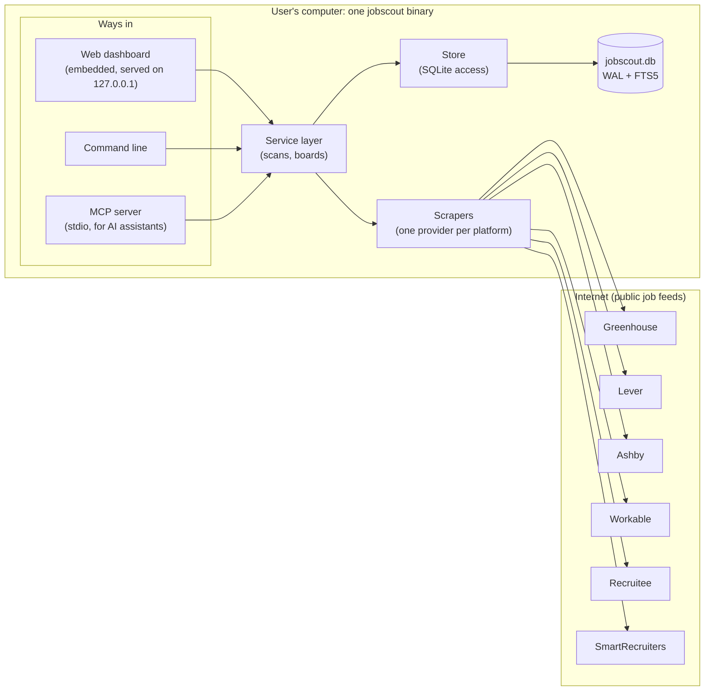

Three front doors (dashboard, CLI, MCP) share one service layer, so a rule such as "closed jobs are never deleted"
is enforced in one place no matter who is asking.

## Layers

Dependencies point **inward only**. Transports never talk to scrapers, and `domain` imports nothing.

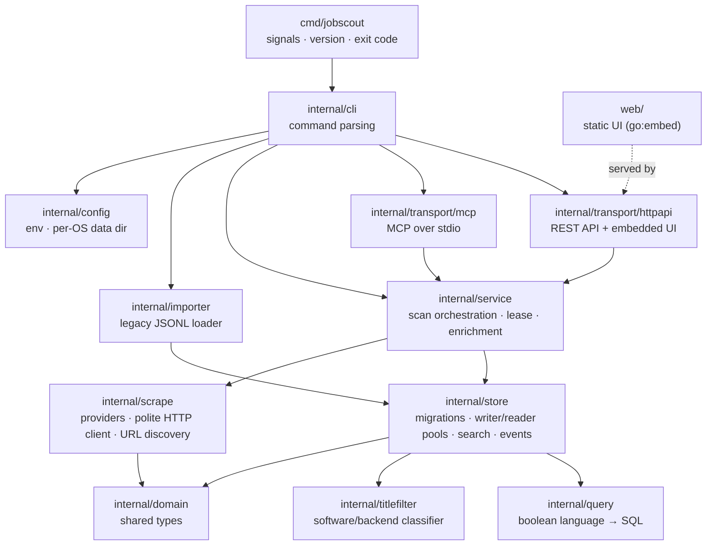

| Package | Responsibility |
|---|---|
| `cmd/jobscout` | Process entry point: signal handling, version, exit code |
| `internal/cli` | Commands (`init`, `scan`, `search`, `serve`, `mcp`, `board`, `saved`, `import`, `maintenance`, `backup`) |
| `internal/transport/httpapi` | REST API + embedded UI; Host guard, CSRF header, CSP, body limits, request IDs |
| `internal/transport/mcp` | MCP server; read-only by default; audit-logged writes |
| `internal/service` | Scan orchestration, cross-process lease, description enrichment, board management |
| `internal/scrape` | Providers (Ashby, Greenhouse, Lever, Recruitee, Workable, SmartRecruiters), HTTP client, HTML→text, URL canonicalisation, board-URL discovery |
| `internal/store` | SQLite: migrations, single writer, read pool, search, events, saved searches, locks, maintenance |
| `internal/query` | Boolean search language → SQL over the FTS index |
| `internal/titlefilter` | Software/backend title classifier (`is_target`) |
| `internal/importer` | Loader for the legacy Python JSONL snapshots |
| `internal/config` | Environment variables and the per-OS data directory |
| `internal/domain` | Shared types |
| `web/` | Static UI, embedded with `go:embed` |

## A sync, step by step

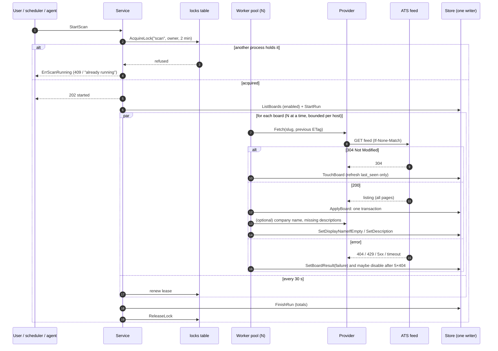

Key properties:
- **One failing company never fails the sync.** Failures are recorded per board; the run errors only if *every* board fails.
- **Politeness:** retries with backoff and `Retry-After`, a per-host concurrency cap, conditional requests, a response-size cap.
- **Cancellable:** `Service.Close` (Ctrl+C on `serve`) cancels the run and waits for it before the database closes.

## How one job is applied

`ApplyBoard` loads the board's existing jobs in **one query**, then decides per job inside a single transaction:

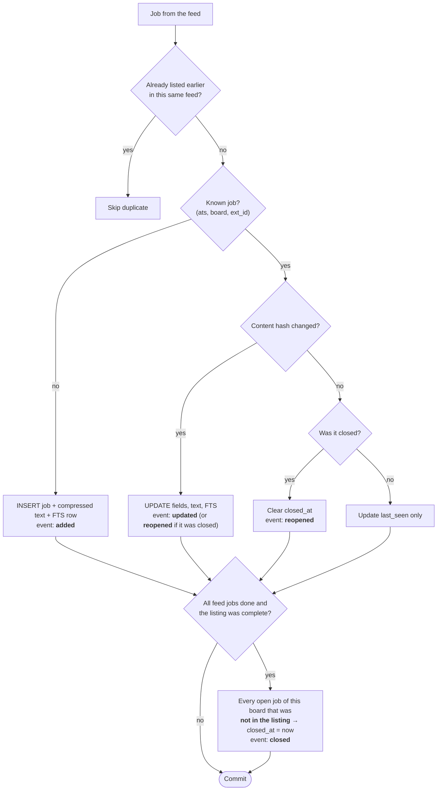

"Complete" is false when the feed returned an empty list for a board that previously had jobs. That is more likely a
glitch upstream than every job closing at once, so nothing is closed in that case.

### Job lifecycle

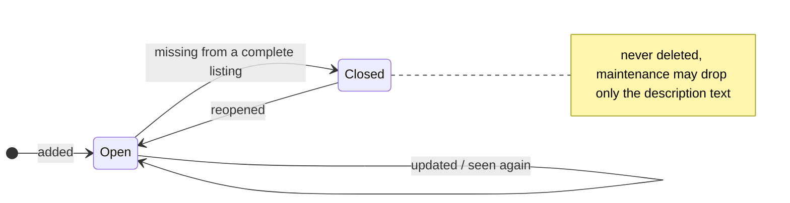

## A search request

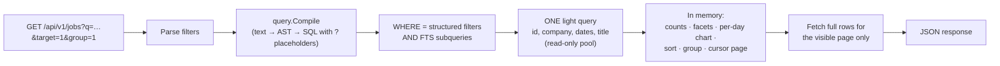

The full-text match runs **once** per request no matter how many counts and facets the page shows.

### The query language

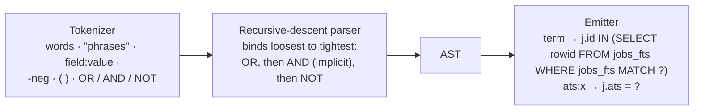

- Terms longer than three characters become FTS prefix queries (`agent` → `"agent"*`); shorter ones match whole tokens (`AI`).
- Plain words are restricted to the `title` column unless the scope is `tcl` (title, company, location) or `all`.
- Malformed input degrades gracefully: unbalanced parentheses close implicitly, stray operators are ignored, control
  characters are stripped. `FuzzSearch` checks that no input can make a search fail.

## Data model

One SQLite file in WAL mode (see [ADR 0002](adr/0002-sqlite-as-the-datastore.md)).

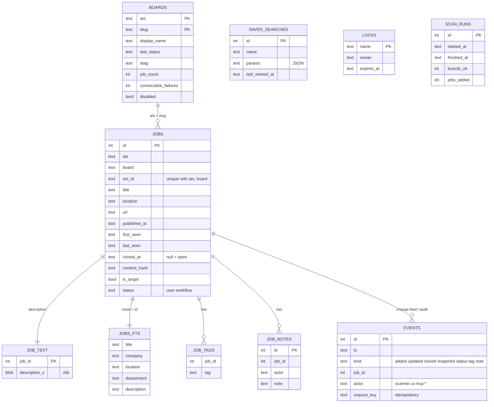

| Table | Purpose |
|---|---|
| `jobs` | one row per posting, unique on `(ats, board, ext_id)` |
| `job_text` | descriptions (zlib-compressed), kept apart so list queries never read large text |
| `jobs_fts` | FTS5 contentless index; the `company` column holds the slug and display name |
| `job_tags`, `job_notes` | user and agent annotations |
| `events` | append-only change feed and audit log |
| `boards` | boards to scan, with health and display name |
| `saved_searches` | named search parameters (JSON) and `last_viewed_at` |
| `locks` | cross-process leases (the scan lease) |
| `scan_runs` | history of scans |
| `schema_version` | applied migrations |

**Invariants**
- Jobs are never deleted. A job missing from a *complete* listing is marked `closed_at`; if it returns it is reopened.
- Closing is decided by membership in the listing, never by timestamps (two scans in the same second behave correctly).
- A `304 Not Modified` refreshes `last_seen` without rewriting rows.
- All timestamps are UTC RFC 3339 strings, so lexical comparison is chronological.
- A board is disabled after 5 consecutive `404`s; any successful scan resets the counter.
- A user-set company name is never overwritten by a name learned from a feed.

**Migrations** are numbered SQL files in `internal/store/migrations`, embedded in the binary and applied in order
inside a transaction at startup. Never edit a released migration; add a new one.

## Concurrency

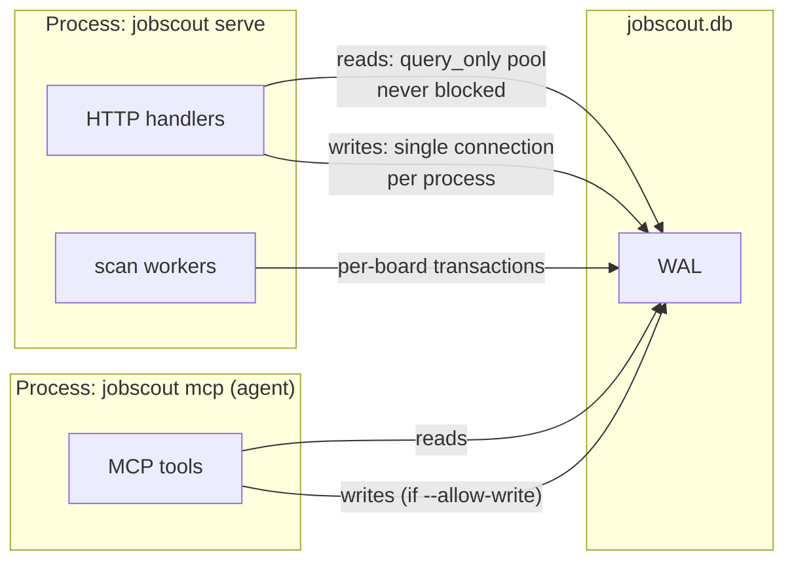

- **Within a process**, all writes go through one connection, so they serialise without `SQLITE_BUSY` surprises.
  Reads use a separate pool of `query_only` connections that WAL lets run alongside the writer.
- **Across processes**, SQLite's file lock serialises writers (with a 10 s busy timeout), and the `scan` lease ensures
  only one sync runs at a time:

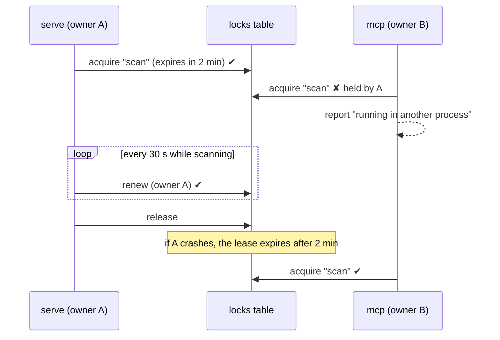

**Description enrichment.** Providers whose listings lack descriptions (SmartRecruiters) implement
`DescriptionFetcher`; after a board is applied the service fetches descriptions for at most 50 new jobs per board per
scan, so large employers fill in over several syncs without flooding the platform.

## Security model

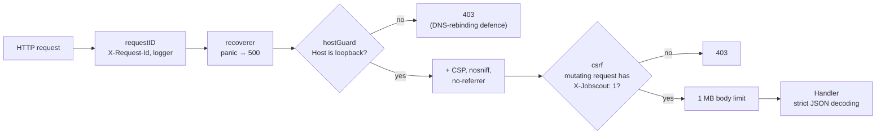

- The server binds to loopback; the Host check stops DNS-rebinding attacks from websites.
- Cross-site pages can't add the custom header without a CORS preflight, which the server never approves.
- Strict CSP: no inline scripts, no third-party origins. The UI renders scraped text with `textContent` only.
- CSV export prefixes cells beginning with `= + - @` so spreadsheets don't execute them.
- MCP write tools are off unless `--allow-write`; every write is attributed in `events`; job text is labelled untrusted for agents.
- The data directory is created `0700`.

## Adding an ATS provider

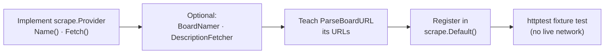

1. Implement `scrape.Provider` in `internal/scrape/<name>.go`. **`Fetch` must return the complete listing or an error,
   never a partial list**, because missing jobs are marked closed.
2. Optionally implement `BoardNamer` (company name) and `DescriptionFetcher` (per-posting descriptions).
3. Add its URL shapes to `ParseBoardURL` so users can add boards by pasting a link.
4. Register it in `scrape.Default()`.
5. Add a fixture-driven test with `httptest` (see `providers_test.go`). Only public feeds; see [ADR 0004](adr/0004-polite-scraping-of-public-feeds.md).
