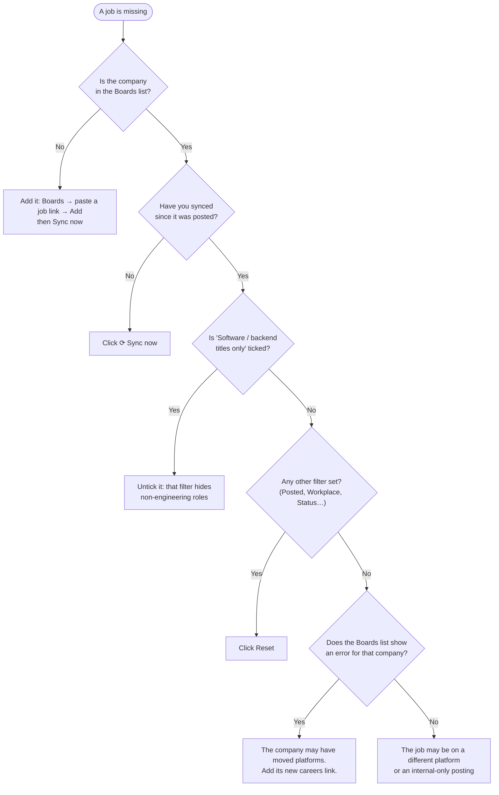

# FAQ & Troubleshooting

**Jump to:** [Getting started](#getting-started) · [Jobs and companies](#jobs-and-companies) · [Searching](#searching) · [Data and privacy](#data-and-privacy) · [Error messages](#error-messages)

---

## Getting started

### Do I need to know how to code?
No. Download, unzip, double-click ([User Guide → Installing](user-guide.md#installing)). Everything else happens in your browser.

### Mac says "Apple cannot check it for malicious software" (or "unidentified developer")
jobscout isn't signed with a paid Apple certificate. Open **System Settings → Privacy & Security**, scroll down, click
**Open Anyway** next to *jobscout*, and confirm. You only need to do this once.
([Step by step](user-guide.md#if-your-computer-blocks-it))

### Windows says "Windows protected your PC"
Click **More info → Run anyway**. If your antivirus moved the file to quarantine, restore it and mark it as allowed.

### A window flashed and disappeared (Windows)
That shouldn't happen with a double-click: on any problem jobscout keeps the window open and says what went wrong.
If it does, your antivirus may have stopped it. Check its quarantine list.

### The window says "another program is already using 127.0.0.1:8765"
Something else on your computer uses the same address. Close that program and double-click jobscout again. Or, from a
terminal, start jobscout on another port: `jobscout serve --addr 127.0.0.1:8800`, then open <http://127.0.0.1:8800>.

### I double-clicked jobscout twice
No problem. The second time it notices jobscout is already running and just opens your browser.

### The browser didn't open
Open <http://127.0.0.1:8765> yourself. If it says the site can't be reached, the jobscout window was closed. Double-click jobscout again.

### The dashboard says "No jobs yet"
On the very first start jobscout fetches openings from about 150 companies. This takes a minute or two and the list
fills in by itself. If nothing happens, click **⟳ Sync now** and check your internet connection.

---

## Jobs and companies

### Why is a job I saw on the company's website missing?

### What does "closed" mean? Did the company reject me?
No. **Closed** only means the job disappeared from the company's public list, usually because it was filled or paused.
It has nothing to do with your application. jobscout keeps closed jobs (with your notes) so you have a record; tick
**Include closed** to see them.

### A company's link says "unrecognised URL"
That company uses a hiring platform jobscout doesn't read yet (for example Workday, iCIMS or Taleo). Supported:
Greenhouse, Lever, Ashby, Workable, Recruitee and SmartRecruiters. You can request a platform by opening an issue on GitHub.

### Why does a company show as "disabled"?
Its job page returned "not found" five syncs in a row. Usually the company moved to another platform or closed its page.
Open **Boards** and click **Enable** to try again, or add its new careers link.

### Why are company names written oddly, like "Andurilindustries"?
Some platforms don't share the company's display name, so jobscout guesses from the web address. Fix it once in
**Boards → Rename**; the new name is also searchable.

### Some SmartRecruiters jobs have no description
SmartRecruiters needs one request per job to fetch descriptions, so jobscout fetches up to 50 per company per sync to
stay polite. The rest fill in over the next few syncs. The **Open posting ↗** link always works.

### The first sync found thousands of "new" jobs
Everything is new the first time. From the second sync on, **NEW** means genuinely new that day.

---

## Searching

### My search finds nothing
- `OR`, `AND`, `NOT` must be capitals: `backend OR frontend`, not `backend or frontend`.
- By default only **titles** are searched. For a skill like *Rust* that's usually in the description, set **Search in → Everything**.
- Check the filters, or click **Reset**.

### My search finds too much
- Exclude words with a minus: `engineer -senior -staff -manager`.
- Use an exact phrase in quotes: `"data engineer"`.
- Combine with filters: **Posted → Last 7 days**, **Workplace → remote**.

### The same job appears several times
Many companies post one opening per city. Tick **Group locations** to show it once, with all cities listed.

---

## Data and privacy

### Where is my data, and who can see it?
In one file on your computer ([locations](user-guide.md#backups-and-moving-to-a-new-computer)). jobscout has no
account and no server of its own. The only things it sends over the internet are requests for the public job lists. The
dashboard address `127.0.0.1` is reachable only from your own computer.

### Will updating or deleting jobscout delete my jobs?
No. The program and your data live in different places. Updating replaces the program only. To remove your data
too, delete the data folder.

### How big does the database get?
Roughly 150–250 MB for ~150 companies after a few months. To shrink it, run
`jobscout maintenance --prune-closed 90d --vacuum`. This drops the descriptions of jobs closed more than 90 days ago but
keeps the jobs, your notes and your statuses.

### Is it OK to scrape these sites?
jobscout reads the public job feeds that hiring platforms publish for exactly this kind of use (career pages and job
widgets). It identifies itself, limits how fast it asks, and backs off when a site asks it to. Please don't change those limits.

---

## Error messages

| Message | What it means | What to do |
|---|---|---|
| **a scan is already running** | A sync is in progress (maybe started by the schedule or another window). | Wait for it; progress shows next to **Sync now**. |
| **That search could not be parsed** | Very rare; usually stray symbols. | Simplify the search or click **Reset**. |
| **Server not reachable** | The jobscout window was closed. | Double-click jobscout again; the page reloads. |
| **not_found** next to a company in Boards | That company's page is gone. | Add its new careers link, or disable it. |
| **rate_limited** next to a company | The platform asked jobscout to slow down. | Nothing to do; it retries automatically next sync. |
| **every board failed** | jobscout couldn't reach any site. | Check your internet connection, then click **Sync now**. It also retries next time you open jobscout. |
| **database is locked** | Another program (for example a backup tool) is holding the file. | Wait a moment and try again. |
