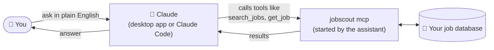
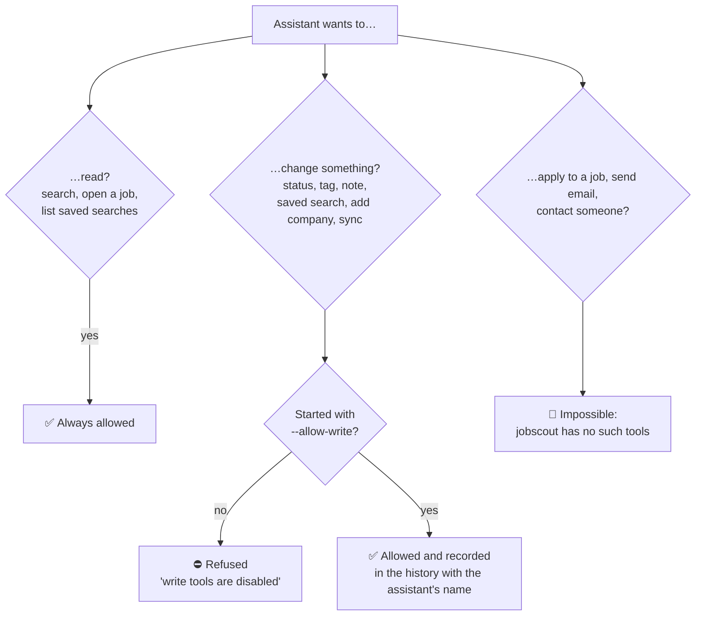
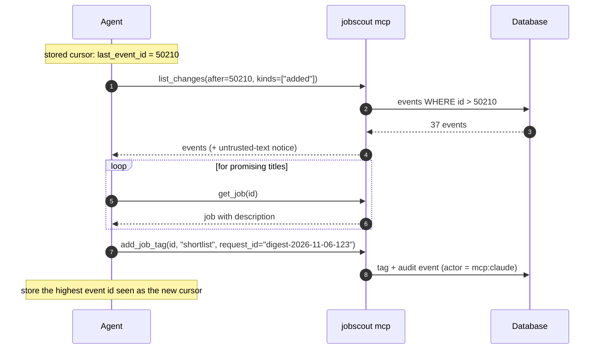

# Using jobscout with an AI assistant

jobscout can connect to AI assistants such as **Claude** so you can ask about your jobs in plain English:

> *"What backend roles were posted this week at companies with fewer than 500 people? Tag the remote ones 'shortlist'."*
>
> *"Summarise the new jobs in my 'AI & agents' saved search and tell me which ones ask for Go."*
>
> *"Mark the Stripe backend role as applied and add a note: referred by Priya."*

It uses **MCP** (Model Context Protocol), the standard way assistants connect to tools on your computer.



The assistant starts jobscout itself when it needs it. You don't have to keep anything running.

## Read-only or read-write?

By default the assistant can **only read**. To let it change things (statuses, tags, notes, saved searches, adding
companies, starting a sync), you turn that on explicitly.



## Setting it up

You need the full path to the `jobscout` program, for example `/Users/you/jobscout/jobscout` on a Mac or
`C:\Users\you\jobscout\jobscout.exe` on Windows. On a Mac you can drag the file into Terminal to see its path.

### Claude Desktop
1. Open Claude Desktop → **Settings → Developer → Edit Config**. This opens `claude_desktop_config.json`.
2. Add jobscout (use your own path; on Windows, double every backslash: `C:\\Users\\you\\jobscout\\jobscout.exe`):

   ```json
   {
     "mcpServers": {
       "jobscout": {
         "command": "/Users/you/jobscout/jobscout",
         "args": ["mcp"]
       }
     }
   }
   ```

   For read-write access use `"args": ["mcp", "--allow-write", "--actor", "mcp:claude-desktop"]`.
3. Restart Claude Desktop. jobscout appears in the tools menu.

### Claude Code

```sh
claude mcp add jobscout -- /full/path/to/jobscout mcp                                   # read-only
claude mcp add jobscout -- /full/path/to/jobscout mcp --allow-write --actor mcp:claude  # read-write
```

### Other assistants
Any MCP client works: configure a **stdio** server with command `jobscout` and arguments `["mcp"]`.

## Things to try

| Ask | What happens |
|---|---|
| "What's new in my saved searches?" | `list_saved_searches`, then `run_saved_search` for ones with new jobs |
| "Find remote full-stack roles posted in the last 3 days" | `search_jobs` with `q`, `workplace`, `posted_days` |
| "Read the OpenAI agent-platform job and list the requirements" | `get_job` |
| "What changed since yesterday?" | `list_changes` |
| "Start following https://jobs.lever.co/palantir" | `add_board`, then `run_scan` *(needs --allow-write)* |
| "Tag every remote Go job from this week as 'shortlist'" | `search_jobs`, then `add_job_tag` per job *(needs --allow-write)* |

## Safety

- **Job descriptions are written by other people.** A posting could contain text designed to manipulate an AI
  ("ignore previous instructions…"). jobscout labels all job text as untrusted, and there are no tools that could do
  harm outside your job database.
- **Everything an assistant changes is recorded** in the history (the `list_changes` tool, or `GET /api/v1/events`) with the
  name you gave it (`--actor`), so you can see and undo it.
- Several assistants can use jobscout at the same time, and only one sync ever runs at once.

---

## Reference (for developers)

`jobscout mcp` speaks MCP over stdio (newline-delimited JSON-RPC 2.0). Logs go to stderr; stdout carries protocol only.
Supported protocol versions: 2025-06-18, 2025-03-26, 2024-11-05 (negotiated in `initialize`).

### Tools

| Tool | Writes | Purpose |
|---|---|---|
| `search_jobs` | no | boolean search + filters (`group`, `cursor`); compact rows, no descriptions |
| `get_job` | no | one job with description, tags, notes |
| `list_saved_searches` | no | saved searches with `total` and `new_count` |
| `run_saved_search` | no* | run one; `mark_viewed: true` resets its new counter (*a write) |
| `list_changes` | no | events with `id > after` (added, updated, closed, reopened, status, tag, note) |
| `get_stats`, `scan_status` | no | counts; scan progress in any jobscout process |
| `set_job_status`, `add_job_tag`, `remove_job_tag`, `add_job_note` | yes | annotate jobs; optional `request_id` makes retries safe |
| `save_search` | yes | create or replace a saved search by name |
| `add_board` | yes | track a company from a careers-page or posting URL |
| `run_scan` | yes | start a background scan (refused if any process is already scanning) |

Results are returned as text and as `structuredContent`. Resources: `jobscout://stats`, `jobscout://saved-searches`,
`jobscout://saved-search/{id}`. The query language is the dashboard's (see the [User Guide](user-guide.md#searching)).

### A daily-digest agent



### Patterns

- **Daily digest:** keep the highest event id you've processed; pass it as `after` next time.
- **Triage:** `search_jobs` with `target_only=true, new_today=true`, then `set_job_status` / `add_job_tag`.
- **Pagination:** `limit` (max 100) plus `next_cursor` from the previous response.
- **Retries:** pass a unique `request_id` on writes; repeating the call with the same id applies it once.
