# jobscout User Guide

This guide is for everyone. No programming knowledge is needed. If a word is unfamiliar, check the
[glossary](#glossary) at the end.

**Contents**
1. [What jobscout does](#what-jobscout-does)
2. [Installing](#installing)
3. [Starting and stopping](#starting-and-stopping)
4. [A tour of the dashboard](#a-tour-of-the-dashboard)
5. [A daily routine](#a-daily-routine)
6. [Searching](#searching)
7. [Saved searches](#saved-searches)
8. [Adding a company](#adding-a-company)
9. [Tracking your applications](#tracking-your-applications)
10. [New, open and closed jobs](#new-open-and-closed-jobs)
11. [Keeping it up to date automatically](#keeping-it-up-to-date-automatically)
12. [Exporting to a spreadsheet](#exporting-to-a-spreadsheet)
13. [Backups and moving to a new computer](#backups-and-moving-to-a-new-computer)
14. [Glossary](#glossary)

---

## What jobscout does

Most companies don't post jobs on their own website directly. They use a **hiring platform** (Greenhouse, Lever, Ashby,
Workable, Recruitee or SmartRecruiters) that hosts their careers page. Each of those pages has a public list of openings.

jobscout visits those lists for you, keeps a copy of every opening on your computer, and shows them in one place.

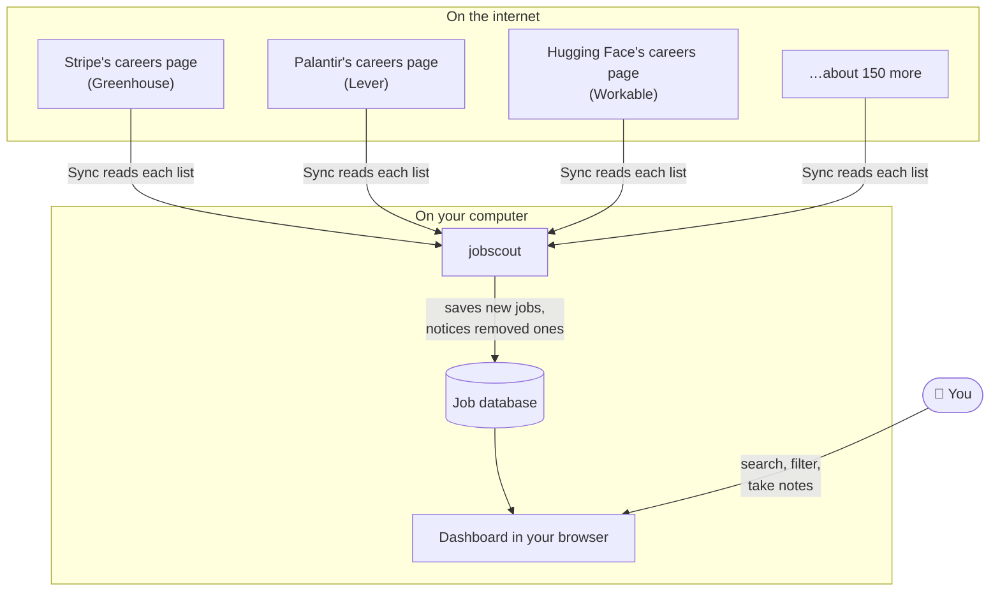

Why this helps:
- You see openings **as soon as companies post them**, often before job sites copy them.
- You get **one list** for many companies instead of visiting each careers page.
- jobscout **remembers**, so it can show what's new since yesterday and which jobs were taken down.

---

## Installing

You only do this once. No installer, no account.

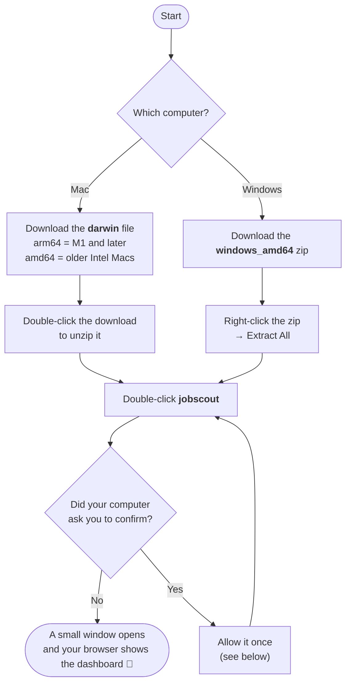

### Not sure which Mac you have?
Click the Apple menu  → **About This Mac**. If it says **Chip: Apple M…**, download `arm64`. If it says **Processor: Intel**, download `amd64`.

### Mac, step by step
1. Go to the [Releases page](https://github.com/manikanta-varaganti/jobscout/releases) and download the file ending in `darwin_arm64.tar.gz` (or `darwin_amd64.tar.gz` for Intel Macs).
2. Double-click it in your Downloads folder. A folder called `jobscout…` appears. You can move it anywhere, for example to Applications.
3. Open the folder and double-click **jobscout**. A Terminal window opens and then your browser.

### Windows, step by step
1. Go to the [Releases page](https://github.com/manikanta-varaganti/jobscout/releases) and download the file ending in `windows_amd64.zip`.
2. In your Downloads folder, right-click it → **Extract All…** → **Extract**.
3. Open the extracted folder and double-click **jobscout.exe**. A black window opens and then your browser.

### If your computer blocks it
jobscout isn't signed with a paid Apple or Microsoft certificate, so the **first** launch asks for confirmation.

- **Mac** ("Apple cannot check it for malicious software" or "unidentified developer"):
  1. Click **Done** (or **Cancel**) on the message.
  2. Open **System Settings → Privacy & Security** and scroll down to *Security*.
  3. Click **Open Anyway** next to *"jobscout" was blocked*, confirm with your password, then click **Open**.

  On older macOS versions you can instead right-click (or Control-click) **jobscout** → **Open** → **Open**.
- **Windows** ("Windows protected your PC"): click **More info → Run anyway**. If your antivirus quarantines it, restore it and allow it.

> **Is it safe?** The program only reads public job lists and runs on your computer. The source code is public, so anyone can check what it does.

---

## Starting and stopping

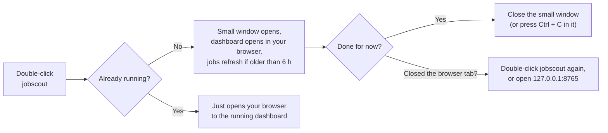

- jobscout runs **while its small window is open**. Closing that window stops it.
- Closing the **browser tab** doesn't stop it. Double-click jobscout again (it won't start a second copy) or open <http://127.0.0.1:8765>.
- Stopping is always safe, even in the middle of a sync. The next time you open jobscout, it finishes the job.
- While it's running, jobs refresh every 6 hours. When you open it after more than 6 hours, it refreshes straight away.
- **127.0.0.1** means "this computer". Nobody else on your network can open your dashboard.

Prefer typing commands?

Open Terminal (Mac) or PowerShell (Windows) in the jobscout folder and run `./jobscout serve` (Mac) or `.\jobscout.exe serve` (Windows).
`jobscout help` lists every command. The [README](../README.md) has the full list under *For developers and power users*.

---

## A tour of the dashboard

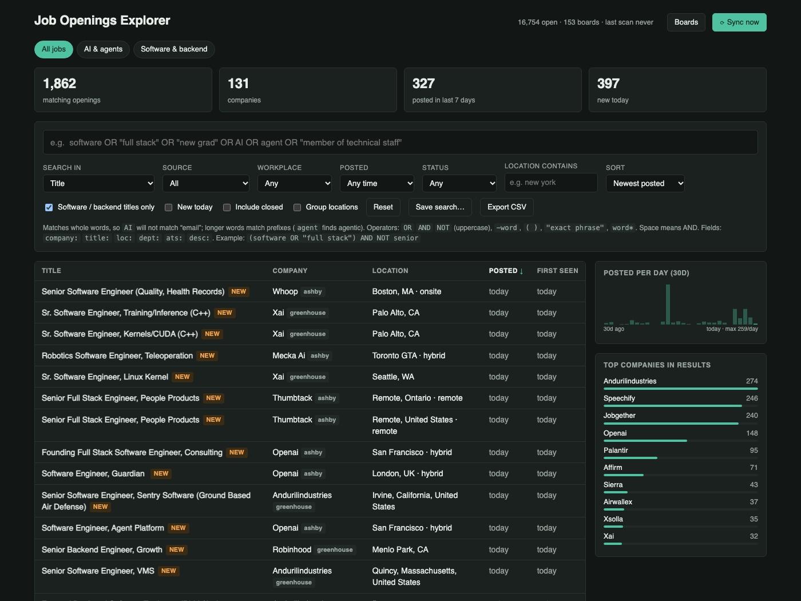

From top to bottom:

| Area | What it's for |
|---|---|
| **⟳ Sync now** (top right) | Fetch the latest openings from every company right now. Progress shows next to the button. (jobscout also does this by itself every 6 hours.) |
| **Boards** | See every company being followed, add a new one, rename or pause one. |
| **Tabs** (*All jobs*, then your saved searches) | One click switches to a saved search. The orange number is how many jobs are new since you last opened it. |
| **Summary boxes** | How many openings match, from how many companies, how many were posted this week, and how many appeared today. |
| **Search box** | Type what you're looking for. See [Searching](#searching). |
| **Filters** | *Source* (hiring platform), *Workplace* (remote/hybrid/on-site), *Posted* (last day/week/month), *Status* (your own labels), *Location contains*. |
| **Software / backend titles only** | A built-in filter for software and backend engineering roles. Untick it to see every job. |
| **New today** / **Include closed** / **Group locations** | Only jobs first seen today / also show jobs that were taken down / show one row per role instead of one per city. |
| **Save search…** / **Export CSV** | Keep the current search for later / download the results for a spreadsheet. |
| **Results table** | Click any row to open its details: the full description, a link to apply, a status picker and notes. **NEW** marks jobs first seen today. |
| **Posted per day** / **Top companies** | A 30-day chart, and the companies with the most matches. Click a company to filter by it. |

---

## A daily routine

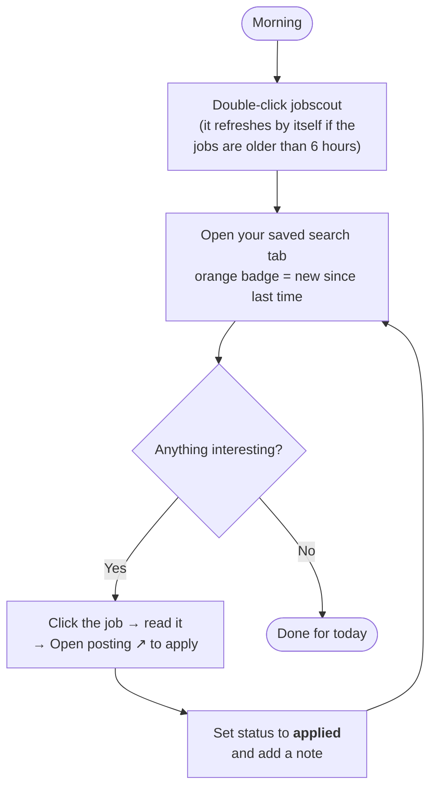

Ten minutes a day is enough to catch new openings within a day of their posting.

---

## Searching

Type words into the search box. Results update as you type.

| You type | You get |
|---|---|
| `backend` | titles containing *backend* |
| `python backend` | titles with **both** words |
| `backend OR "full stack"` | titles with **either** |
| `engineer -senior` | *engineer* but **not** *senior* |
| `"machine learning"` | that exact phrase |
| `(backend OR "full stack") -senior -staff` | either one, without senior or staff roles |
| `company:stripe` | only Stripe's jobs |
| `loc:london` | jobs whose location mentions London |

### How a search is read

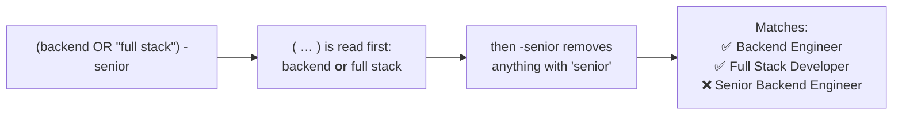

**Good to know**
- `OR`, `AND` and `NOT` must be in **CAPITALS**. Lowercase *or* is searched as a word.
- A space between words means "both".
- Short words match whole words only: `AI` finds "AI Engineer" but not "email". Longer words also match their beginnings: `agent` finds "agentic".
- By default only **job titles** are searched. To search descriptions too, set **Search in → Everything incl. description**. For example, find jobs that mention Rust anywhere.
- Nothing you type can break the search. If the results look odd, click **Reset**.

---

## Saved searches

Save any search, then come back to see **only what's new since you last looked**.

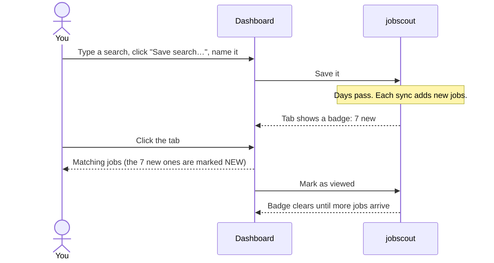

- **To create one:** search and filter until the list looks right → **Save search…** → give it a name.
- **To update one:** open its tab, change the search, then **Save search…** with the same name.
- A starter search called **Software & backend** is already there.

---

## Adding a company

If a company you like isn't followed yet, add it with any link from its careers page.

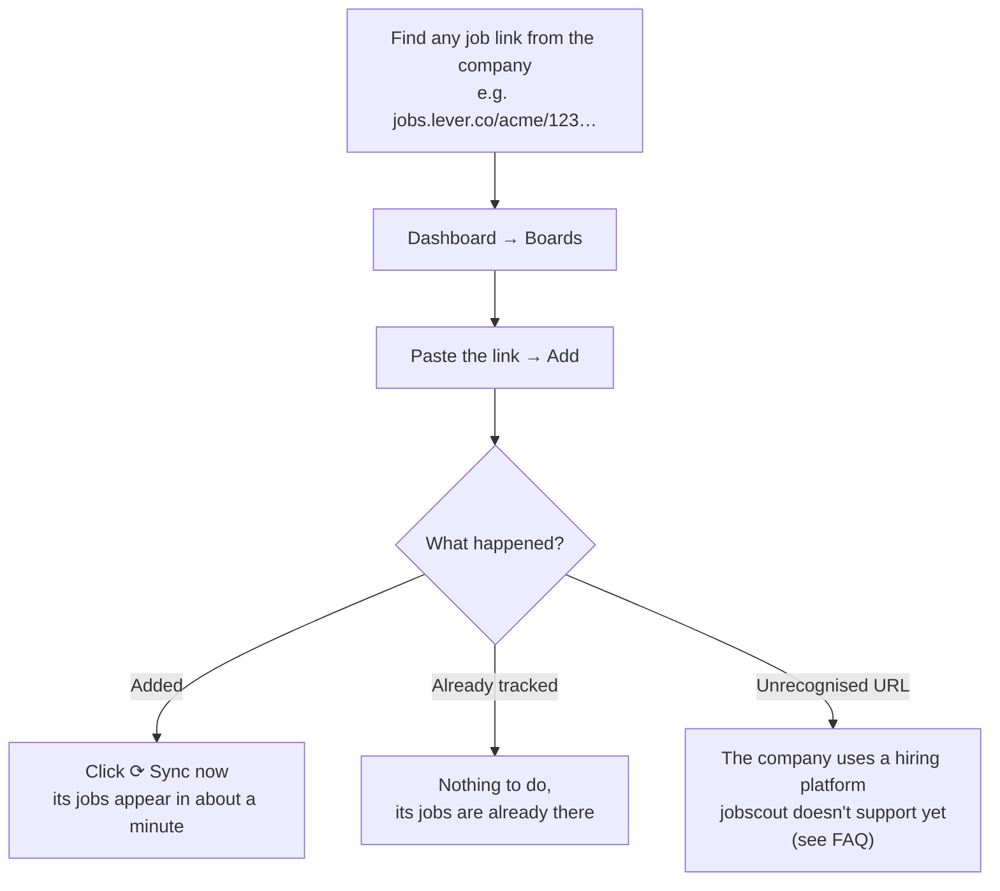

Links that work look like these:

| Platform | Example link |
|---|---|
| Greenhouse | `job-boards.greenhouse.io/discord/jobs/…` |
| Lever | `jobs.lever.co/palantir/…` |
| Ashby | `jobs.ashbyhq.com/openai/…` |
| Workable | `apply.workable.com/huggingface/` (the careers page, not a single-job link) |
| Recruitee | `bunq.recruitee.com/…` |
| SmartRecruiters | `jobs.smartrecruiters.com/Equinox/…` |

**Tip:** On a company's own careers page, click any job. The address it opens often reveals which platform it uses.

In the **Boards** window you can also **Rename** a company (for example *Andurilindustries* → *Anduril Industries*) and
**Disable** one you're no longer interested in. Companies whose page disappears are disabled automatically after five failed syncs.

---

## Tracking your applications

Click a job to open it, then use the **status** picker. These statuses are just labels for you. They don't contact anyone.

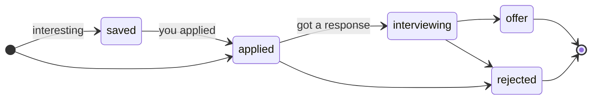

- **Filter by status** (Status → *applied*) to see everything you've applied to.
- **Notes** keep a short history: who referred you, when you followed up. Each note is dated.
- Statuses and notes stay even after the company takes the job down.

---

## New, open and closed jobs

jobscout compares each sync with the previous one:

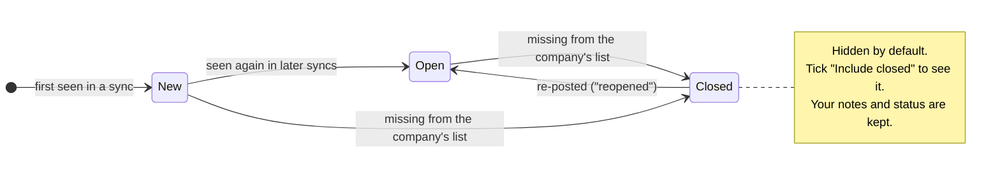

- **NEW** means the job was **first seen today**.
- **Closed** means the company took it down, usually because it's filled or paused. jobscout never deletes it, so your notes stay.
- If a company's page fails to load during a sync, its jobs are **not** marked closed. jobscout only closes jobs when it successfully read the full list and they weren't on it.

---

## Keeping it up to date automatically

When you start jobscout by double-clicking it, it keeps itself up to date:

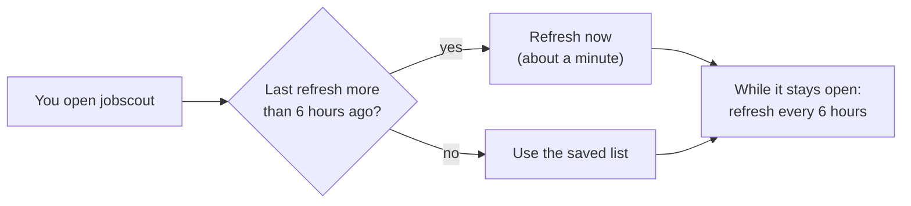

You can still click **⟳ Sync now** at any time. Only one refresh runs at a time; if you click during one, you'll see its progress.

From a terminal you can choose your own schedule: `jobscout serve --scan-every 3h --sync-if-older 3h`.

---

## Exporting to a spreadsheet

Click **Export CSV**. You get a file with **every** job matching your current search and filters (not just the page on
screen). Open it with Excel, Numbers or Google Sheets (File → Import).

---

## Backups and moving to a new computer

Everything you've collected, including notes, statuses and saved searches, lives in one file, `jobscout.db`:

| Computer | Location |
|---|---|
| Mac | `~/Library/Application Support/jobscout/jobscout.db` (in Finder: **Go → Go to Folder…** and paste `~/Library/Application Support/jobscout`) |
| Windows | `%AppData%\jobscout\jobscout.db` (paste `%AppData%\jobscout` into the File Explorer address bar) |

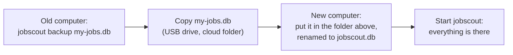

- `jobscout backup my-jobs.db` is safe to run while jobscout is running.
- Time Machine (Mac) and File History (Windows) already include this folder if you use them.
- Updating jobscout to a newer version never touches this file.

---

## Glossary

| Term | Meaning |
|---|---|
| **Hiring platform** | The service a company uses to publish jobs and receive applications (Greenhouse, Lever, Ashby, Workable, Recruitee, SmartRecruiters). Developers call this an *ATS* (applicant tracking system). |
| **Board** | One company's job list on one hiring platform. jobscout follows *boards*. |
| **Sync** (also *scan*) | jobscout visiting every board and updating your database. |
| **Database** | The single file on your computer where jobscout keeps everything. |
| **New** | First seen today. |
| **Closed** | No longer on the company's list. Kept for your records. |
| **Saved search** | A search you named so you can reopen it with one click and see what's new. |
| **The small window** | The Terminal (Mac) or console (Windows) window that opens when you double-click jobscout. jobscout runs while it's open. |
| **Terminal / PowerShell** | Text windows where you can type commands (optional; you don't need them). |
| **127.0.0.1:8765** | The address of the dashboard on your own computer. Only you can open it. |
| **MCP** | The standard way AI assistants like Claude connect to tools. See [AI assistants](mcp.md). |

Still stuck? See the [FAQ & Troubleshooting](faq.md).
